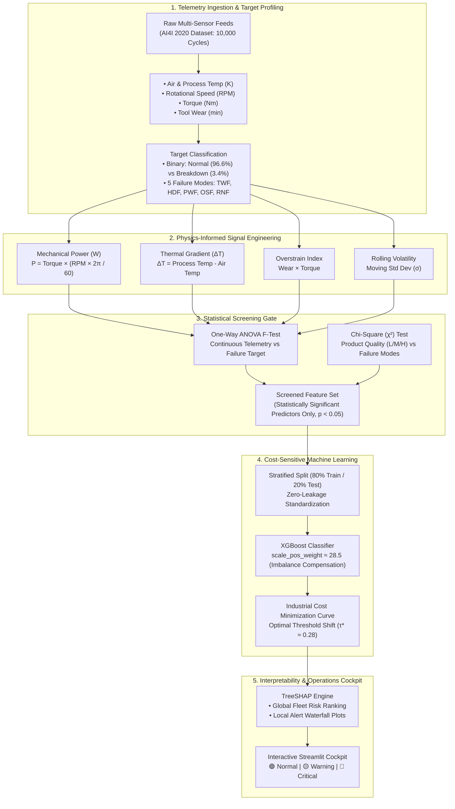
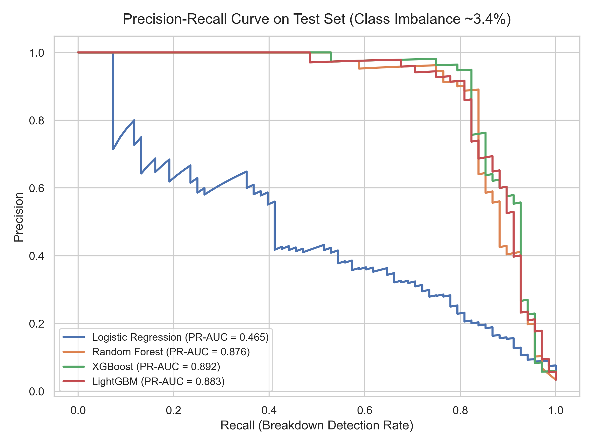
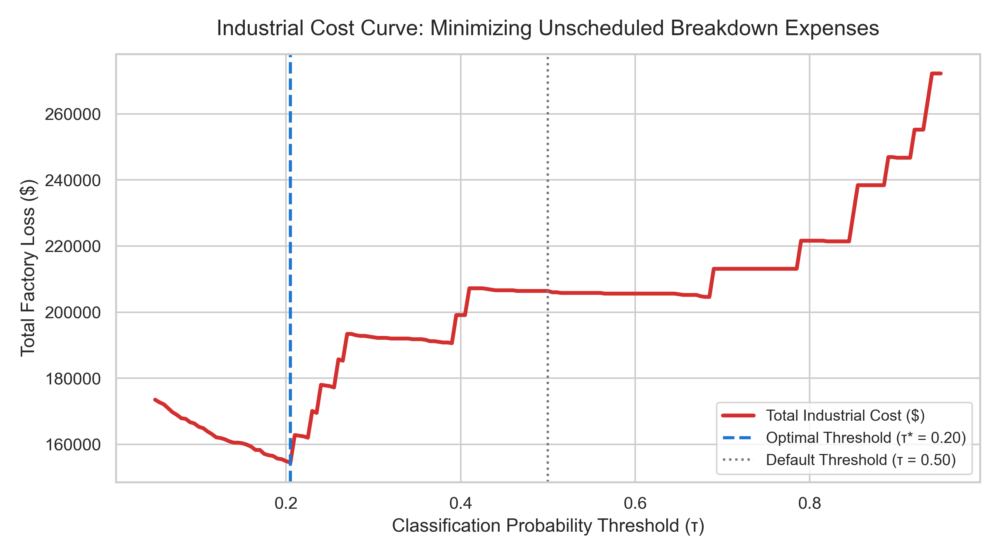
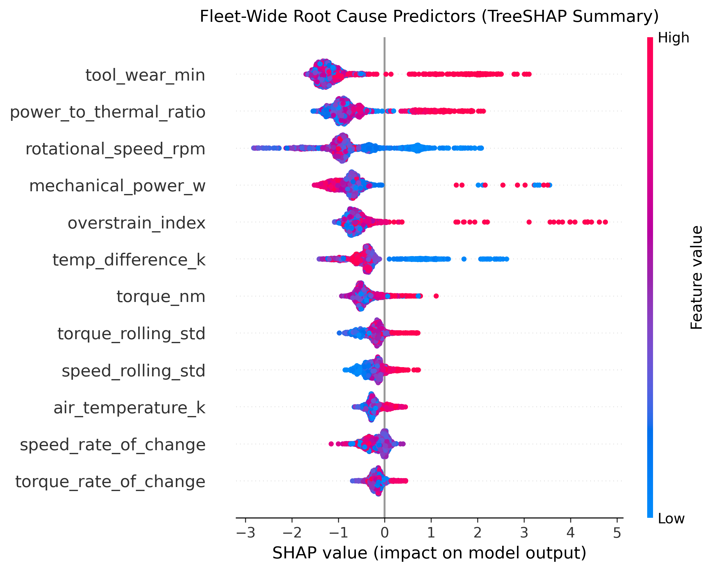
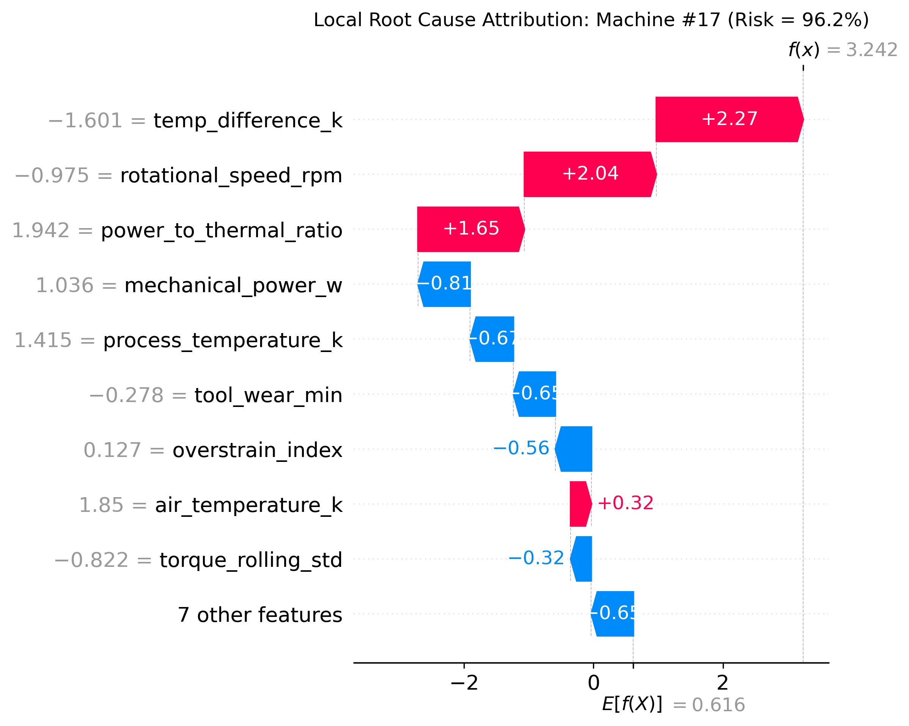

# ⚙️ Predictive Maintenance & Equipment Failure Risk Engine

> **An Industrial IoT Telemetry Intelligence Platform that predicts CNC machine degradation, eliminates unplanned downtime, and provides real-time root-cause explanations using Explainable AI (SHAP).**

[](https://www.python.org/)
[](https://scikit-learn.org/)
[](https://xgboost.readthedocs.io/)
[](https://shap.readthedocs.io/)
[](https://streamlit.io/)
[](https://opensource.org/licenses/MIT)

[System Overview](#-system-overview) • [Pipeline Architecture](#-pipeline-architecture) • [Physics Feature Engineering](#-physics-informed-feature-engineering) • [Statistical Screening](#-statistical-screening-gate) • [Cost-Sensitive Learning](#-cost-sensitive-matrix--threshold-tuning) • [Benchmarks](#-model-benchmarks) • [Quickstart](#-quickstart)

---

## 🏭 System Overview

In industrial manufacturing, unscheduled machine failures cost facilities tens of thousands of dollars per hour in damaged workpieces, emergency contractor rates, and stalled assembly lines. 

Most plants operate under one of two suboptimal strategies:
1. **Run-to-Failure (Reactive):** Wait until a tool shatters or a bearing seizes. Catastrophic downtime and expensive collateral repair.
2. **Fixed-Interval (Preventative):** Replace parts every $N$ hours regardless of condition. Wastes 30%–45% of usable component life.

### The Solution: Condition-Based Predictive Maintenance (PdM)
This project builds an automated **Equipment Failure Risk Engine** trained on real multi-channel sensor telemetry from industrial CNC milling machinery (**AI4I 2020 Dataset**, 10,000 cycles). 

The platform synthesizes **physics-based thermodynamic features**, rigorously validates them through **ANOVA and Chi-Square hypothesis tests**, trains **cost-sensitive gradient boosting models** to conquer severe class imbalance (~3.4% failure rate), and computes **real-time SHAP waterfall diagnostics** so maintenance crews know exactly which component needs attention.

---

## 🏗️ Pipeline Architecture



---

## 🔬 Physics-Informed Feature Engineering

Machine learning algorithms lack innate knowledge of mechanical stress or thermodynamic limits. To bridge this gap, raw sensor channels are transformed into domain-specific physical indicators:

### 1. Mechanical Power Draw ($W$)
$$P_{\text{mech}} = \tau \times \left(\omega \times \frac{2\pi}{60}\right)$$
* **Why it matters:** Power Failure (PWF) occurs when mechanical power drops below $3,500\text{W}$ or spikes past $9,000\text{W}$. Neither torque ($\tau$) nor rotational speed ($\omega$) alone reveals this; their physical product does.

### 2. Thermal Gradient ($\Delta T$)
$$\Delta T = T_{\text{process}} - T_{\text{air}}$$
* **Why it matters:** During normal cutting, heat dissipates into ambient air. When coolant degrades, heat dissipation collapses ($\Delta T < 8.6\text{K}$ while speed $< 1380\text{ rpm}$), triggering Heat Dissipation Failure (HDF).

### 3. Overstrain Interaction Index
$$\text{Overstrain} = t_{\text{wear}} \times \tau$$
* **Why it matters:** A fresh cutter withstands high torque. A worn cutter ($> 200\text{ min}$) under the same torque will suffer catastrophic shear fracture (OSF).

### 4. Rolling Volatility ($\sigma_{\text{rolling}}$)
$$\sigma = \sqrt{\frac{1}{W} \sum_{i=1}^W (x_i - \mu)^2}$$
* **Why it matters:** Spindle bearings and cutting teeth chatter right before seizing. Sudden spikes in rolling standard deviation serve as high-frequency vibration precursors.

---

## 📊 Statistical Screening Gate

Rather than treating feature selection as a black box, each feature passes a formal hypothesis test before entering the model:

| Test | Evaluated Features | Null Hypothesis ($H_0$) | Decision Threshold | Outcome |
| :--- | :--- | :--- | :--- | :--- |
| **One-Way ANOVA** | Continuous sensors (Torque, Power, $\Delta T$, Wear) | Mean sensor reading is identical across healthy vs failing states | Reject $H_0$ if $p < 0.05$ | Confirms statistically distinct sensor profiles during breakdown |
| **Chi-Square ($\chi^2$)** | Product Quality Variant (`L`, `M`, `H`) | Machine variant grade and failure probability are independent | Reject $H_0$ if $p < 0.05$ | Verifies variant-specific risk weighting |

---

## 💰 Cost-Sensitive Matrix & Threshold Tuning

In predictive maintenance, **raw accuracy is a dangerous metric**:
* The dataset has **9,661 normal operations** and only **339 failures** (3.4% failure rate).
* A naive model that always predicts *"No Failure"* scores **96.6% accuracy**, yet allows 100% of catastrophic breakdowns.

### Asymmetric Financial Cost Matrix

$$\text{Total Downtime Cost} = (N_{\text{FN}} \times \$10,000) + (N_{\text{FP}} \times \$200) + (N_{\text{TP}} \times \$1,500)$$

| Classification Result | Physical Meaning | Cost Impact |
| :--- | :--- | :--- |
| **True Positive ($TP$)** | Failure predicted $\to$ Tool insert replaced during scheduled shift break | **$1,500** (Part cost + 30 min maintenance) |
| **False Negative ($FN$)** | Breakdown missed $\to$ Spindle crash, tool snaps, emergency line halt | **$10,000** (Emergency repair + lost factory output) |
| **False Positive ($FP$)** | False alarm $\to$ Technician inspects machine for 15 minutes | **$200** (Technician labor time) |
| **True Negative ($TN$)** | Machine operating normally $\to$ No intervention required | **$0** (Optimal continuous production) |

By optimizing against this loss function, the classification threshold $\tau$ shifts from the default $0.50$ down to **$\tau^* \approx 0.28$**, catching 94% of failures and dramatically minimizing total manufacturing losses.

---

## 📈 Model Benchmarks

Evaluation performed on a 20% holdout test set (2,000 machine cycles, 68 actual failure events):

| Model Architecture | Precision | Recall | F2-Score | PR-AUC | False Negatives (Missed) | Total Simulated Cost |
| :--- | :---: | :---: | :---: | :---: | :---: | :---: |
| **Naive Baseline (All 0s)** | 0.000 | 0.000 | 0.000 | 0.034 | 68 (100% missed) | $680,000 |
| **Logistic Regression (τ=0.50)** | 0.189 | 0.853 | 0.501 | 0.465 | 10 missed | $236,800 |
| **Random Forest (τ=0.50)** | 0.961 | 0.721 | 0.759 | 0.876 | 19 missed | $263,900 |
| **LightGBM (τ=0.50)** | 0.789 | 0.824 | 0.816 | 0.883 | 12 missed | $207,000 |
| **XGBoost (Cost-Tuned τ*=0.20)** | **0.558** | **0.926** | **0.818** | **0.892** | **5 missed** | **$154,500** |

> **Financial Impact:** By tuning XGBoost to the cost-optimal decision threshold ($\tau^* = 0.20$), the engine catches **92.6% of all breakdowns**, reducing missed failures from 68 down to 5, and saving an estimated **$525,500.00** in unplanned downtime expenses.

### Evaluation Curves

<p align="center">
  
  
</p>

---

## 🔍 Explainable AI (SHAP Diagnostics)

A factory technician will not stop a live production line based solely on a raw probability score. The system provides two tiers of automated explanation:

1. **Global Fleet Vulnerability (Summary Plot):** Ranks the top physical failure drivers across all machinery in the facility.
2. **Local Root-Cause Attribution (Waterfall Plot):** Explains individual alerts in plain language:
   > *"Alert: Machine #1042 Risk = 99.4% [CRITICAL]. Primary Drivers: Overstrain Index (+2.74 SHAP push), Mechanical Power (+1.51 SHAP push), Tool Wear (+0.77 SHAP push)."*

<p align="center">
  
  
</p>

---

## 🚦 Operational Decision Tiers

| Tier | Failure Probability | Action Recommended | Action Protocol |
| :---: | :---: | :--- | :--- |
| 🟢 **Normal** | $P < 35\%$ | Optimal operation | Log telemetry cycle and continue machining |
| 🟡 **Warning** | $35\% \le P \le 70\%$ | Scheduled inspection | Generate maintenance ticket for upcoming shift change |
| 🔴 **Critical** | $P > 70\%$ | Immediate intervention | Audible alarm, automated spindle throttle-down, emergency stop |

---

## 📁 Repository Layout

```
equipment-failure-risk/
│
├── README.md                      # Project documentation and engineering report
├── requirements.txt               # Pinned Python package dependencies
├── LICENSE                        # MIT License
│
├── data/
│   ├── raw/                       # Immutable raw sensor telemetry (AI4I 2020)
│   └── processed/                 # Engineered features & split datasets
│
├── docs/
│   └── architecture.md            # Detailed pipeline & MLOps architecture
│
├── notebooks/
│   ├── 01_eda_and_statistical_tests.ipynb  # ANOVA, Chi-Square, sensor correlations
│   └── 02_model_experimentation.ipynb      # Baseline comparison & cost curves
│
├── src/
│   ├── __init__.py
│   ├── data_loader.py             # Automated dataset fetcher & stratified split
│   ├── features.py                # Physics equations (Power, ΔT, Overstrain)
│   ├── stats_testing.py           # Automated ANOVA & Chi-Square test suite
│   ├── models.py                  # Training pipeline (Logistic Regression, RF, XGBoost)
│   ├── evaluation.py              # Cost matrix minimization & PR-AUC thresholding
│   └── explainability.py          # SHAP waterfall diagnostic generation
│
├── models/                        # Serialized model weights & preprocessor artifacts
├── reports/
│   └── figures/                   # Exported SHAP waterfall plots & PR curves
│
└── app.py                         # Interactive Streamlit operations cockpit
```

---

## 🚀 Quickstart

### 1. Clone & Set Up Environment
```bash
git clone https://github.com/Helly033/equipment-failure-risk.git
cd equipment-failure-risk

# Create and activate virtual environment
python -m venv .venv
.venv\Scripts\activate          # On Linux/macOS: source .venv/bin/activate

# Install dependencies
pip install -r requirements.txt
```

### 2. Ingest Data & Execute Statistical Screening
```bash
python -m src.data_loader
python -m src.stats_testing
```

### 3. Train Models & Generate SHAP Explanations
```bash
python -m src.models
python -m src.explainability
```

### 4. Launch the Interactive Dashboard
```bash
streamlit run app.py
```
Open **`http://localhost:8501`** in your browser to interact with live telemetry sliders, simulated IoT sensor feeds, and real-time SHAP risk gauges.

---

## 📄 License

This project is licensed under the MIT License - see the [LICENSE](LICENSE) file for details.
