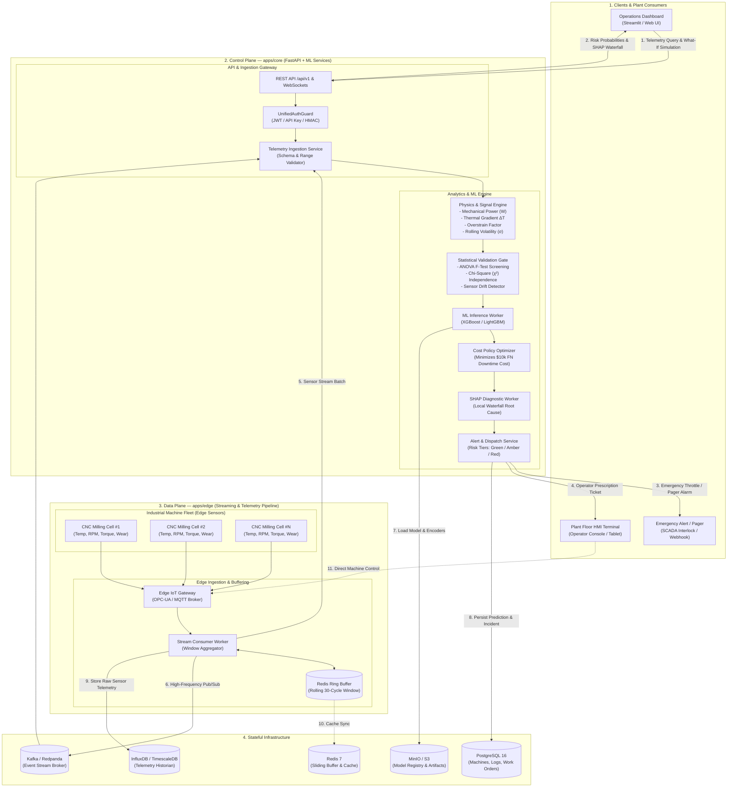

# Predictive Maintenance & Equipment Failure Risk Engine

[](https://www.python.org/)
[](https://scikit-learn.org/)
[](https://xgboost.readthedocs.io/)
[](https://shap.readthedocs.io/)
[](https://streamlit.io/)
[](https://opensource.org/licenses/MIT)

> An end-to-end Industrial IoT Machine Learning system that predicts manufacturing equipment breakdowns before catastrophic failure, quantifies downtime financial risk, and explains root causes using Explainable AI (SHAP).

---

## 📌 Executive Summary

Unplanned industrial downtime costs manufacturing plants an estimated **$50 billion annually**. Traditional maintenance relies on either:
1. **Reactive Maintenance:** Run-to-failure (causes costly emergency shutdowns).
2. **Preventative Maintenance:** Fixed-interval replacements (wastes thousands of hours of remaining part life).

This project implements an **Industrial Risk Engine** that ingests real-time telemetry (temperatures, rotational speeds, torque, and tool wear), applies **physics-informed feature engineering**, screens signals using **statistical hypothesis testing (ANOVA & $\chi^2$)**, and predicts breakdowns using **cost-optimized gradient boosting**.

---

## 🏗️ Enterprise System Architecture



*For complete architectural specifications, see [docs/architecture.md](docs/architecture.md).*

---

## 🛠️ Technology Stack

| Domain | Technology / Library | Role in Project |
| :--- | :--- | :--- |
| **Language** | `Python 3.10 / 3.11` | Primary development environment |
| **Data Processing** | `Pandas`, `NumPy` | Vectorized sensor transformations and rolling statistics |
| **Statistical Analysis** | `SciPy (scipy.stats)` | ANOVA F-tests and Chi-Square tests of independence |
| **Machine Learning** | `Scikit-Learn` | Preprocessing pipelines, baselines, and cross-validation |
| **Gradient Boosting** | `XGBoost`, `LightGBM` | High-precision classification on imbalanced tabular data |
| **Model Interpretability** | `SHAP` | TreeSHAP global impact and local waterfall explanations |
| **Visualization** | `Matplotlib`, `Seaborn` | EDA charts, PR curves, and confusion matrices |
| **Application / UI** | `Streamlit` | Interactive operational risk dashboard |

---

## 🔬 Core Innovations & Workflow

### 1. Physics-Informed Feature Engineering
Rather than treating sensors as disconnected numbers, we introduce thermodynamic and mechanical equations:
* **Mechanical Power ($W$):** $P = \text{Torque} \times \left(\text{RPM} \times \frac{2\pi}{60}\right)$
* **Thermal Gradient ($\Delta T$):** $\Delta T = \text{Process Temp} - \text{Air Temp}$
* **Overstrain Index:** $\text{Tool Wear} \times \text{Torque}$

### 2. Statistical Screening Gate
* **One-Way ANOVA:** Validates that telemetry distributions across failure vs. healthy states are statistically distinct ($p < 0.05$).
* **Chi-Square ($\chi^2$):** Analyzes whether product variant grades (`L`, `M`, `H`) correlate with specific failure modes (Tool Wear, Heat Dissipation, Overstrain).

### 3. Business Cost Matrix & Threshold Tuning
In predictive maintenance, **False Negatives** (missed failures) are exponentially more expensive than **False Positives** (unnecessary 15-minute checkups).
* Cost of False Negative: **$10,000** (unplanned downtime, broken spindle)
* Cost of False Positive: **$200** (technician inspection)
* We optimize the classification threshold $\tau$ to minimize **Total Expected Industrial Cost**, not arbitrary accuracy.

### 4. Explainable AI with SHAP
Every alert provides maintenance crews with an automated diagnostic:
> *"Machine #1042 Risk: 84% [CRITICAL]. Primary drivers: Tool Wear reached 215 min (+42% risk), Mechanical Power dropped below safe threshold (+26% risk)."*

---

## 📂 Repository Layout

```
equipment-failure-risk/
│
├── .gitignore
├── README.md
├── requirements.txt
│
├── data/
│   ├── raw/                       # Immutable raw sensor telemetry
│   └── processed/                 # Engineered features & split datasets
│
├── docs/
│   └── architecture.md            # Detailed system architecture document
│
├── notebooks/
│   ├── 01_eda_and_statistical_tests.ipynb  # ANOVA, Chi2, sensor distributions
│   └── 02_model_experimentation.ipynb      # Baseline vs XGBoost & Cost Curve
│
├── src/
│   ├── __init__.py
│   ├── data_loader.py             # Data fetching & train/test split
│   ├── features.py                # Physics equations & rolling statistics
│   ├── stats_testing.py           # Automated ANOVA & Chi-Square screening
│   ├── models.py                  # Training pipeline (XGBoost, Random Forest)
│   ├── evaluation.py              # Cost matrix, PR-AUC, threshold optimization
│   └── explainability.py          # SHAP calculation & plot generators
│
├── models/                        # Serialized champion models and scalers
├── reports/
│   └── figures/                   # Exported SHAP plots and evaluation charts
│
└── app.py                         # Interactive Streamlit Risk Engine application
```

---

## 🚀 Quickstart

### 1. Clone & Set Up Environment
```bash
git clone https://github.com/<your-username>/equipment-failure-risk.git
cd equipment-failure-risk

# Create and activate virtual environment
python -m venv .venv
source .venv/bin/activate  # On Windows: .venv\Scripts\activate

# Install dependencies
pip install -r requirements.txt
```

### 2. Run the Statistical Analysis & Model Pipeline
```bash
python -m src.data_loader
python -m src.stats_testing
python -m src.models
```

### 3. Launch the Interactive Dashboard
```bash
streamlit run app.py
```

---

## 📄 License
This project is licensed under the MIT License - see the LICENSE file for details.
