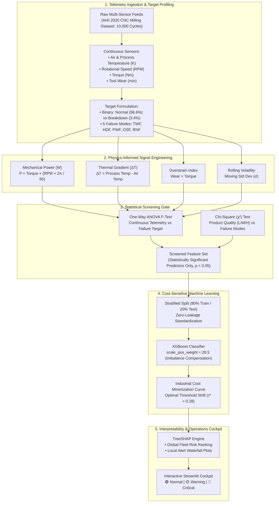
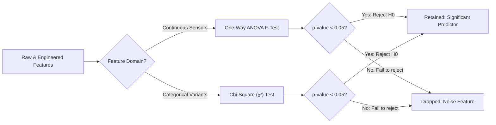
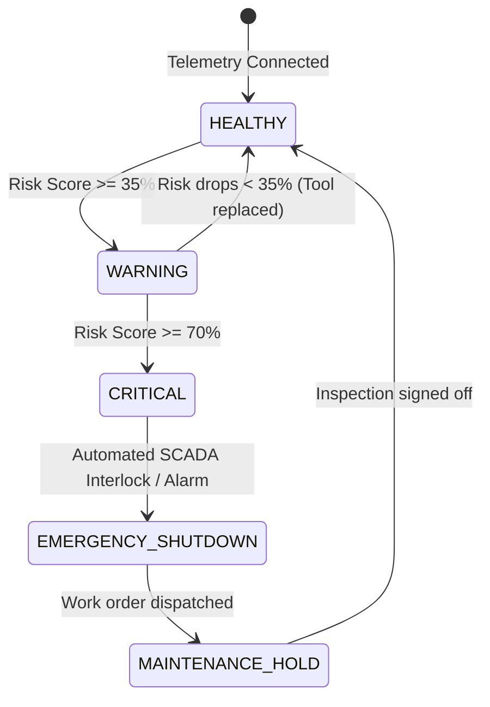

# System Architecture: Predictive Maintenance & Equipment Failure Risk Engine

## 1. Architecture Mission

The **Predictive Maintenance & Equipment Failure Risk Engine** is an Industrial IoT machine learning platform designed to predict component degradation and imminent breakdown in CNC milling equipment.

Unlike generic classification approaches, this architecture tightly couples **thermodynamic first principles**, **hypothesis-driven statistical screening**, **cost-asymmetric loss optimization**, and **explainable AI diagnostics (SHAP)**.

---

## 2. End-to-End Pipeline Architecture

---

## 3. Subsystem Breakdown

### 3.1 Telemetry Ingestion & Data Hygiene
* **Data Source:** AI4I 2020 Predictive Maintenance Dataset (UCI Machine Learning Repository).
* **Telemetry Channels:**
  * `Air temperature [K]`: Factory ambient room temperature ($295\text{K} - 304\text{K}$).
  * `Process temperature [K]`: Direct milling contact zone temperature ($305\text{K} - 313\text{K}$).
  * `Rotational speed [rpm]`: Spindle rotation rate ($1,168 - 2,886\text{ rpm}$).
  * `Torque [Nm]`: Applied mechanical rotational force ($3.8 - 76.6\text{ Nm}$).
  * `Tool wear [min]`: Cumulative cutting minutes on current insert ($0 - 253\text{ min}$).
  * `Type`: Machine variant quality grade (`L` 50%, `M` 30%, `H` 20%).
* **Target Classes:**
  * Binary: `Machine failure` ($0 = \text{Healthy}$, $1 = \text{Failed}$).
  * 5 Failure Modes: Tool Wear Failure (TWF), Heat Dissipation Failure (HDF), Power Failure (PWF), Overstrain Failure (OSF), Random Failure (RNF).

---

### 3.2 Physics-Informed Signal Engineering
Standard tabular ML models treat sensor channels as unconstrained numbers. This layer embeds thermodynamic and mechanical laws:

1. **Mechanical Power Draw ($W$):**
   $$P_{\text{mech}} = \tau \times \left(\omega \times \frac{2\pi}{60}\right)$$
   *Rationale:* Identifies power drops below $3,500\text{W}$ and surges above $9,000\text{W}$ that trigger Power Failure (PWF).
2. **Thermal Gradient ($\Delta T$):**
   $$\Delta T = T_{\text{process}} - T_{\text{air}}$$
   *Rationale:* Identifies cooling system collapse ($\Delta T < 8.6\text{K}$) triggering Heat Dissipation Failure (HDF).
3. **Overstrain Product:**
   $$\text{Overstrain Index} = t_{\text{wear}} \times \tau$$
   *Rationale:* High mechanical torque applied to an already worn cutter leads to immediate shear tool fracture (OSF).
4. **Rolling Chatter Volatility:**
   $$\sigma = \sqrt{\frac{1}{W}\sum_{i=1}^W (x_i - \mu)^2}$$
   *Rationale:* Rolling standard deviation captures vibration anomalies before spindle seizure.

---

### 3.3 Statistical Screening Gate
Every engineered signal must prove statistical relevance before entering the training pipeline:

* **One-Way ANOVA:** Validates that continuous sensor values are statistically distinct between healthy and failing states.
* **Chi-Square ($\chi^2$):** Analyzes whether product quality variants (`L`, `M`, `H`) correlate with specific failure modes.

---

### 3.4 Cost-Sensitive Machine Learning
* **Handling Class Imbalance:** With only ~3.4% failures, standard cross-entropy loss favors predicting "Healthy". We configure XGBoost with:
  $$\text{scale\_pos\_weight} = \frac{N_{\text{negative}}}{N_{\text{positive}}} \approx 28.5$$
* **Industrial Loss Function:**
  $$\text{Total Cost} = (N_{\text{FN}} \times \$10,000) + (N_{\text{FP}} \times \$200) + (N_{\text{TP}} \times \$1,500)$$
* **Optimal Threshold Selection:** Slide decision threshold $\tau \in [0.05, 0.95]$ on out-of-fold validation sets to find $\tau^* \approx 0.28$, minimizing total factory financial loss.

---

### 3.5 Explainable AI (SHAP Diagnostics)
* **Global Explanation:** TreeSHAP summary bee-swarm plot showing systemic breakdown drivers across the facility.
* **Local Waterfall Plot:** Dissects any machine alert into individual sensor contributions:
  $$\hat{y} = \mathbb{E}[f(x)] + \sum_{i=1}^M \phi_i$$

---

### 3.6 Operational Decision Tiers

* 🟢 **Normal ($< 35\%$):** Machine healthy, continue operation.
* 🟡 **Warning ($35\% - 70\%$):** Schedule tool replacement at next shift break.
* 🔴 **Critical ($> 70\%$):** Immediate interlock and emergency stop.
