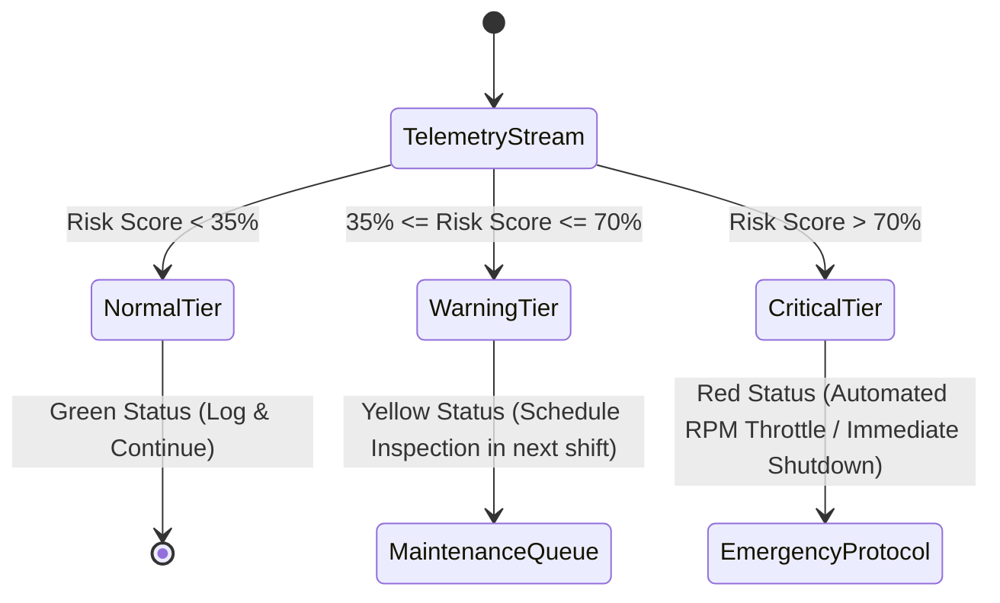

# System Architecture: Predictive Maintenance & Equipment Failure Risk Engine

## 1. Executive System Overview

The **Predictive Maintenance & Equipment Failure Risk Engine** is an industrial IoT analytics platform designed to predict component degradation and impending machine breakdown in manufacturing environments.

Rather than relying on basic classification, this architecture integrates **physics-informed domain engineering**, **rigorous statistical screening (ANOVA & $\chi^2$)**, **cost-sensitive machine learning**, and **explainable AI (SHAP)** to deliver actionable maintenance decisions.

---

## 2. High-Level End-to-End System Architecture

```mermaid
flowchart TD
    subgraph INGESTION["1. Telemetry Ingestion"]
        S1["Air / Process Temp (K)"]
        S2["Rotational Speed (RPM)"]
        S3["Torque (Nm)"]
        S4["Tool Wear (min)"]
        RAW[("Raw Sensor Feed<br/>AI4I 2020 Dataset")]
        S1 --> RAW
        S2 --> RAW
        S3 --> RAW
        S4 --> RAW
    end

    subgraph FE["2. Feature Engineering & Signal Processing"]
        FE_PHY["Physics-Informed Features<br/>- Mechanical Power (W)<br/>- Thermal Gradient ΔT<br/>- Overstrain Factor"]
        FE_TIME["Time-Series Dynamics<br/>- Rolling Window Mean/Std<br/>- Rate of Change (Δsensor/Δt)"]
        RAW --> FE_PHY
        RAW --> FE_TIME
    end

    subgraph STATS["3. Statistical Hypothesis Testing Gate"]
        ANOVA["ANOVA F-Test<br/>Continuous Telemetry vs Failure"]
        CHI2["Chi-Square Test (χ²)<br/>Machine Variant vs Failure Modes"]
        FE_PHY --> STATS
        FE_TIME --> STATS
        STATS --> FE_FILTERED["Screened Feature Matrix<br/>(Statistically Significant Predictors)"]
    end

    subgraph ML["4. Cost-Sensitive Risk Modeling"]
        SPLIT["Stratified Group Split<br/>(Leakage Prevention)"]
        MODEL["XGBoost / LightGBM<br/>(scale_pos_weight optimization)"]
        CALIB["Probability Calibration &<br/>Cost Matrix Threshold Tuning"]
        FE_FILTERED --> SPLIT --> MODEL --> CALIB
    end

    subgraph XAI["5. Explainable AI (SHAP)"]
        SHAP_GLOB["Global Feature Drivers<br/>(Fleet-Wide Vulnerabilities)"]
        SHAP_LOC["Local Waterfall Explanation<br/>(Root Cause per Machine Alert)"]
        CALIB --> XAI
    end

    subgraph SERVING["6. Serving & Industrial Decision Engine"]
        API["FastAPI / Inference Engine"]
        UI["Streamlit Risk Dashboard"]
        TIER["Multi-Tier Decision Matrix<br/>🟢 Normal (<35%)<br/>🟡 Warning (35-70%)<br/>🔴 Critical (>70%)"]
        CALIB --> API --> UI
        XAI --> UI
        API --> TIER
    end
```

---

## 3. Subsystem Breakdown

### 3.1 Data Ingestion & Signal Layer
* **Sources**: Continuous multi-sensor channels measuring rotational speed, torque, air/process temperature, and cumulative tool wear.
* **Failure Modes Covered**:
  1. **Tool Wear Failure (TWF)**: Gradual tool degradation exceeding replacement thresholds.
  2. **Heat Dissipation Failure (HDF)**: Inability to radiate process heat into ambient air ($\Delta T < 8.6\text{K}$ and speed $< 1380\text{ rpm}$).
  3. **Power Failure (PWF)**: Mechanical power falling outside safe bounds ($P < 3500\text{W}$ or $P > 9000\text{W}$).
  4. **Overstrain Failure (OSF)**: Product of tool wear and applied torque exceeding mechanical shear limits.
  5. **Random Failure (RNF)**: Uncorrelated process anomalies.

---

### 3.2 Physics-Informed Feature Engineering Layer

Standard ML models struggle with raw sensor values if physical laws are ignored. This layer injects physical constraints:

1. **Mechanical Power Calculation ($W$):**
   $$\text{Power} = \text{Torque [Nm]} \times \left(\text{Rotational Speed [rpm]} \times \frac{2\pi}{60}\right)$$
2. **Thermal Gradient ($\Delta T$):**
   $$\Delta T = \text{Process Temperature [K]} - \text{Air Temperature [K]}$$
3. **Overstrain Interaction Index:**
   $$\text{Overstrain Index} = \text{Tool Wear [min]} \times \text{Torque [Nm]}$$
4. **Thermal Dissipation Efficiency:**
   $$\text{Dissipation Ratio} = \frac{\Delta T}{\text{Rotational Speed}}$$
5. **Rolling Statistical Volatility:**
   * Moving mean ($\mu$) and standard deviation ($\sigma$) across rolling windows to capture vibration flutter and mechanical instability.

---

### 3.3 Statistical Hypothesis Testing Gate

Instead of treating feature selection as an arbitrary step, this architecture implements formal statistical hypothesis testing:

| Test Type | Target Pair | Null Hypothesis ($H_0$) | Decision Rule |
| :--- | :--- | :--- | :--- |
| **One-Way ANOVA** | Continuous Telemetry vs. Binary Failure | Mean sensor reading is identical across normal and failure states. | Reject $H_0$ if $p < 0.05$; feature retained for model input. |
| **Chi-Square ($\chi^2$)** | Product Quality (`L`, `M`, `H`) vs. Failure Modes | Machine type and failure rate are completely independent. | Reject $H_0$ if $p < 0.05$; validates product variant risk weighting. |

---

### 3.4 Cost-Sensitive Modeling & Threshold Tuning

In manufacturing, symmetric loss functions (like accuracy) fail because errors have wildly asymmetric financial consequences:

$$\text{Cost Matrix: } C(\hat{y}, y)$$

| Reality \ Prediction | Predicted Normal ($\hat{y} = 0$) | Predicted Failure ($\hat{y} = 1$) |
| :--- | :--- | :--- |
| **Actual Normal ($y = 0$)** | **$0** (Optimal) | **$200** (False Positive: 15-minute technician inspection) |
| **Actual Failure ($y = 1$)** | **$10,000** (False Negative: Catastrophic breakdown, line stoppage) | **$1,500** (True Positive: Scheduled preemptive part replacement) |

* **Optimization Objective:** Minimize Total Industrial Cost:
  $$\text{Expected Cost} = N_{FP} \cdot C_{FP} + N_{FN} \cdot C_{FN} + N_{TP} \cdot C_{TP}$$
* **Threshold Search:** Slide classification threshold $\tau \in [0.05, 0.95]$ on out-of-fold validation probabilities to find the exact cost-minimizing decision boundary.

---

### 3.5 Model Explainability (XAI) Architecture

Operators will not shut down an active production line based solely on a raw probability score. The XAI pipeline bridges this trust gap:

* **Global Explainability (TreeSHAP)**: Identifies which sensors drive systemic machine vulnerability across the whole plant.
* **Local Explainability (SHAP Waterfall Plots)**: For any machine exceeding the alert threshold, decomposes the prediction:
  $$\hat{y} = \mathbb{E}[f(x)] + \sum_{i=1}^{M} \phi_i$$
  Where $\phi_i$ represents the exact contribution of sensor $i$ to the failure risk.

---

### 3.6 Industrial Decision Matrix (Operational Tiers)



---

## 4. Repository & Code Architecture

```
equipment-failure-risk/
│
├── .gitignore                     # Git tracking exclusions
├── README.md                      # Project documentation and quickstart
├── requirements.txt               # Pinned dependencies
│
├── data/
│   ├── raw/                       # Immutable raw sensor telemetry
│   └── processed/                 # Engineered features & split datasets
│
├── docs/
│   └── architecture.md            # System architecture specification
│
├── notebooks/
│   ├── 01_eda_and_statistical_tests.ipynb  # ANOVA, Chi2, sensor distributions
│   └── 02_model_experimentation.ipynb      # Baseline vs XGBoost & Cost Curve
│
├── src/
│   ├── __init__.py
│   ├── data_loader.py             # Dataset fetching, validation, and splitting
│   ├── features.py                # Physics equations & rolling statistics
│   ├── stats_testing.py           # Automated ANOVA & Chi-Square screening
│   ├── models.py                  # Training pipeline (XGBoost, Random Forest)
│   ├── evaluation.py              # Cost matrix, PR-AUC, threshold optimization
│   └── explainability.py          # SHAP calculation & plot generators
│
├── models/                        # Serialized champion models and scalers
├── reports/
│   └── figures/                   # Exported SHAP plots, PR curves, cost curves
│
└── app.py                         # Interactive Streamlit Risk Engine application
```
