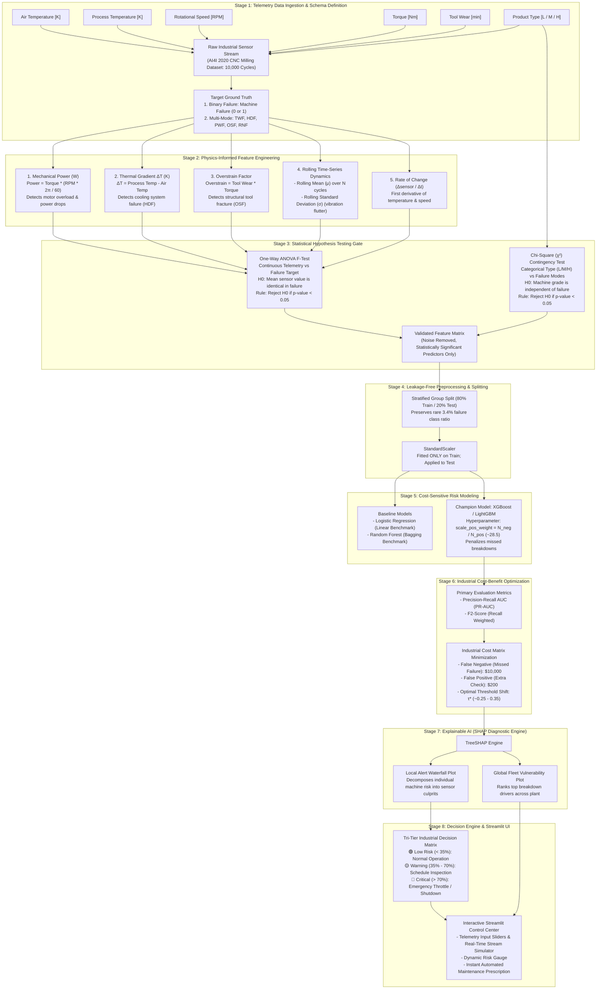
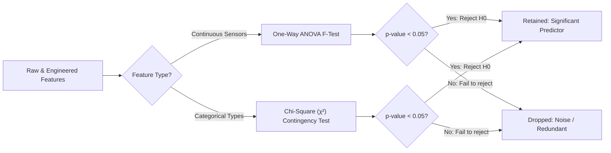
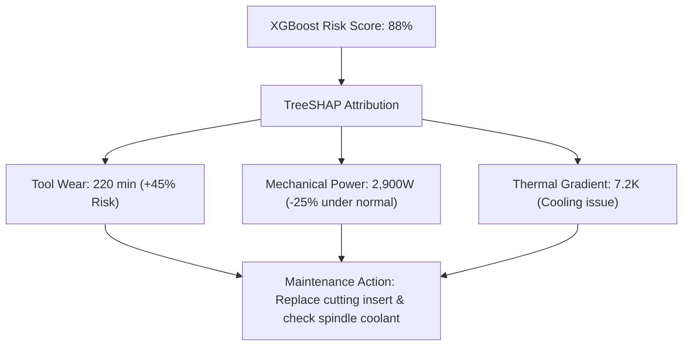

# Complete End-to-End System Architecture & Workflow Specification

## Project: Predictive Maintenance & Equipment Failure Risk Engine
**Domain:** Industrial IoT / Smart Manufacturing  
**Target:** Predict machine breakdown, isolate failure modes, optimize financial downtime cost, and provide real-time XAI diagnostics.

---

## 1. Visual Master Architecture Flowchart



---

## 2. Step-by-Step Workflow Deep-Dive

Here is the exact step-by-step breakdown of how data travels through this system, what mathematical transformations occur, and why each stage exists:

```
Telemetry Feed ──> Physics FE ──> Hypothesis Gate ──> Split ──> XGBoost ──> Cost Matrix ──> SHAP ──> Actionable Dashboard
```

---

### Stage 1: Telemetry Data Ingestion & Problem Formulation

#### What Happens:
The engine ingests continuous sensor records from industrial milling equipment (AI4I 2020 dataset).

#### Data Schema:
| Sensor / Feature | Units | Physical Significance | Normal Range |
| :--- | :--- | :--- | :--- |
| **Air Temperature** | Kelvin ($K$) | Ambient factory room temperature | $295\text{K} - 304\text{K}$ |
| **Process Temperature** | Kelvin ($K$) | Working temperature at the milling interface | $305\text{K} - 313\text{K}$ |
| **Rotational Speed** | Revolutions/min ($\text{rpm}$) | Spindle motor rotation rate | $1168 - 2886\text{ rpm}$ |
| **Torque** | Newton-meters ($\text{Nm}$) | Mechanical rotational force applied | $3.8 - 76.6\text{ Nm}$ |
| **Tool Wear** | Minutes ($\text{min}$) | Cumulative tool cutting time in current run | $0 - 253\text{ min}$ |
| **Product Type** | Categorical | Quality grade: `L` (Low: 50%), `M` (Med: 30%), `H` (High: 20%) | Discrete |

#### Target Definitions:
1. **Machine Failure (Binary Target):** `0` = Healthy, `1` = Failure occurred.
2. **Failure Modes (Multi-Mode Target):**
   * **TWF (Tool Wear Failure):** Tool worn beyond critical threshold ($200 - 240\text{ min}$).
   * **HDF (Heat Dissipation Failure):** Difference between Process and Air Temp $< 8.6\text{K}$ combined with rotational speed $< 1380\text{ rpm}$.
   * **PWF (Power Failure):** Mechanical power drops below $3500\text{W}$ or spikes above $9000\text{W}$.
   * **OSF (Overstrain Failure):** Combination of high tool wear and high mechanical torque exceeding shear tolerance.
   * **RNF (Random Failure):** Uncorrelated process failure ($0.1\%$ probability).

#### The Class Imbalance Challenge:
* **Normal Operation:** $9,661$ rows ($96.6\%$)
* **Failure Events:** $339$ rows ($3.4\%$)
* **Why it matters:** Standard accuracy metrics are useless (a trivial model that always predicts "Healthy" achieves $96.6\%$ accuracy while missing $100\%$ of catastrophic breakdowns).

---

### Stage 2: Physics-Informed Feature Engineering

Raw sensor readings at a single second don't reveal failure mechanisms. We use physical laws and dynamics to construct high-signal features:

#### 1. Mechanical Power ($W$):
$$\text{Power [Watts]} = \text{Torque [Nm]} \times \left( \text{Rotational Speed [rpm]} \times \frac{2\pi}{60} \right)$$
* **Physical Rationale:** An electrical or motor failure (PWF) occurs when power draws exceed $9000\text{W}$ or drop below $3500\text{W}$. The raw torque or speed alone does not capture this; their physical product does.

#### 2. Thermal Gradient ($\Delta T$):
$$\Delta T = \text{Process Temperature} - \text{Air Temperature}$$
* **Physical Rationale:** Machines cool by transferring heat to ambient air. When cooling fans clog or coolant dries up, heat dissipation collapses ($\Delta T < 8.6\text{K}$).

#### 3. Overstrain Interaction Factor:
$$\text{Overstrain Index} = \text{Tool Wear [min]} \times \text{Torque [Nm]}$$
* **Physical Rationale:** A brand new tool can withstand high torque ($70\text{ Nm}$). But a worn tool ($200\text{ min}$) under the same torque will snap due to cumulative material fatigue.

#### 4. Rolling Volatility & Standard Deviation:
$$\mu_{\text{rolling}} = \frac{1}{W} \sum_{i=1}^W x_i, \quad \sigma_{\text{rolling}} = \sqrt{\frac{1}{W}\sum_{i=1}^W (x_i - \mu_{\text{rolling}})^2}$$
* **Physical Rationale:** Bearings and cutting tools begin to chatter (vibrate) right before seizure. A spike in rolling standard deviation is an early indicator of mechanical instability.

#### 5. Rate-of-Change ($\Delta / \Delta t$):
$$\frac{\Delta \text{Sensor}}{\Delta t} = \text{Sensor}_t - \text{Sensor}_{t-1}$$
* **Physical Rationale:** Catches rapid thermal spikes or sudden drops in spindle speed.

---

### Stage 3: Statistical Hypothesis Testing Gate

Instead of blindly feeding all engineered variables into a black-box model, we apply rigorous statistical validation:



#### Test 1: One-Way ANOVA (Continuous Sensors vs Binary Failure)
* **Null Hypothesis ($H_0$):** The mean value of the sensor (e.g., Torque, Power, Tool Wear) is the same in healthy machines and failing machines ($\mu_{\text{healthy}} = \mu_{\text{failing}}$).
* **Alternative Hypothesis ($H_1$):** The mean sensor value is significantly different in failing states ($\mu_{\text{healthy}} \neq \mu_{\text{failing}}$).
* **Decision Rule:** If $p < 0.05$, the sensor has strong statistical discriminatory power and is passed to the ML engine.

#### Test 2: Chi-Square Test of Independence ($\chi^2$)
* **Null Hypothesis ($H_0$):** Machine quality variant (`L`, `M`, `H`) is independent of failure frequency.
* **Alternative Hypothesis ($H_1$):** Cheaper variants (`L`) fail significantly more frequently than high-grade variants (`H`).
* **Decision Rule:** If $p < 0.05$, product variant is confirmed as a critical risk factor.

---

### Stage 4: Leakage-Free Preprocessing & Splitting

1. **Stratified Split (80% Train, 20% Holdout Test):**
   * Preserves the rare $3.4\%$ failure proportion in both training and test sets.
2. **Strict Leakage Prevention:**
   * Scalers (`StandardScaler`) and encoders (`OneHotEncoder`) are fitted **only on the training split**, then used to transform the test set.

---

### Stage 5: Cost-Sensitive Machine Learning Engine

#### Why Standard Gradient Boosters Need Tuning:
In standard cross-entropy loss, false positives and false negatives are penalized identically. For $3.4\%$ rare failure data, the model will bias towards predicting "Healthy".

#### The Solution:
1. **Baseline Benchmarks:**
   * `LogisticRegression` (Linear baseline)
   * `RandomForestClassifier` (Ensemble bagging baseline)
2. **Champion Model: XGBoost / LightGBM**
   * Configure `scale_pos_weight = \frac{N_{\text{negative}}}{N_{\text{positive}}} \approx 28.5`.
   * This forces the gradient booster to multiply the gradient of failure errors by $28.5\times$, preventing the model from ignoring rare breakdowns.

---

### Stage 6: Industrial Cost Matrix & Optimal Thresholding

In smart manufacturing, classification errors have asymmetric dollar values:

$$\text{Total Plant Cost} = (N_{FN} \times C_{FN}) + (N_{FP} \times C_{FP}) + (N_{TP} \times C_{TP})$$

| Outcome | Industrial Meaning | Estimated Financial Cost |
| :--- | :--- | :--- |
| **True Positive ($TP$)** | Predicted failure correctly $\to$ Scheduled tool replacement during shift break | **$1,500** (Part cost + 30 min maintenance) |
| **False Negative ($FN$)** | Model missed breakdown $\to$ Tool shatters, spindle ruined, emergency factory halt | **$10,000** (Emergency repair + lost production) |
| **False Positive ($FP$)** | False alarm $\to$ Technician inspects machine for 15 minutes, finds no issue | **$200** (Technician labor time) |
| **True Negative ($TN$)** | Machine runs normally $\to$ No action | **$0** (Optimal operation) |

* **Threshold Tuning Process:** We evaluate probability thresholds from $\tau = 0.05$ to $\tau = 0.95$ across the validation set. 
* The cost-optimal threshold $\tau^*$ is chosen where **Total Plant Cost is minimized** (typically shifting from default $0.50$ down to $\sim 0.25 - 0.35$).

---

### Stage 7: Explainable AI (SHAP Diagnostic Engine)

A maintenance technician will not take a $500,000 machine offline because a model outputs "Probability = 0.88". They need to know *what to fix*.



1. **Global Fleet SHAP (Summary Bee-swarm Plot):**
   * Tells plant leadership which sensors across the whole factory are the leading causes of breakdowns (e.g., Tool Wear and Torque instability).
2. **Local Machine SHAP (Waterfall Plot):**
   * Generates a per-machine explanation at the instant an alert fires, showing which exact sensor values pushed the risk score into the danger zone.

---

### Stage 8: Industrial Decision Engine & Streamlit Dashboard

The final output is an interactive web control console:

| Risk Tier | Probability Range ($\tau$) | Plant Floor Action | UI Color Code |
| :--- | :--- | :--- | :--- |
| **🟢 Normal** | $P(\text{Fail}) < 35\%$ | Telemetry logged; normal manufacturing cycle continues. | Green |
| **🟡 Warning** | $35\% \le P(\text{Fail}) \le 70\%$ | Create preventive work order; technician inspects at next shift change. | Amber |
| **🔴 Critical** | $P(\text{Fail}) > 70\%$ | Immediate audible alert; automated spindle throttle-down; emergency shutdown. | Red |

#### UI Features:
1. **Interactive Telemetry Sliders:** Adjust temperature, rotational speed, torque, and tool wear.
2. **Dynamic Risk Meter:** Circular gauge displaying real-time breakdown probability.
3. **Automated Root-Cause Diagnostic:** Embedded SHAP waterfall diagram.
4. **IoT Telemetry Replay / Stream Simulator:** Simulates real-time incoming sensor packets.

---

## Summary of Deliverables

By following this architecture:
1. **Data Pipeline:** Physics-informed transformations of multi-channel telemetry.
2. **Statistical Validation:** Rigorous ANOVA & $\chi^2$ screening proofs.
3. **High-Performance Modeling:** Class-weighted XGBoost with PR-AUC evaluation.
4. **Economic Optimization:** Real-world dollar-cost minimization threshold curve.
5. **Transparency & Trust:** Individual machine root-cause diagnosis via SHAP.
6. **Production Asset:** Interactive Streamlit dashboard ready for demonstration.
