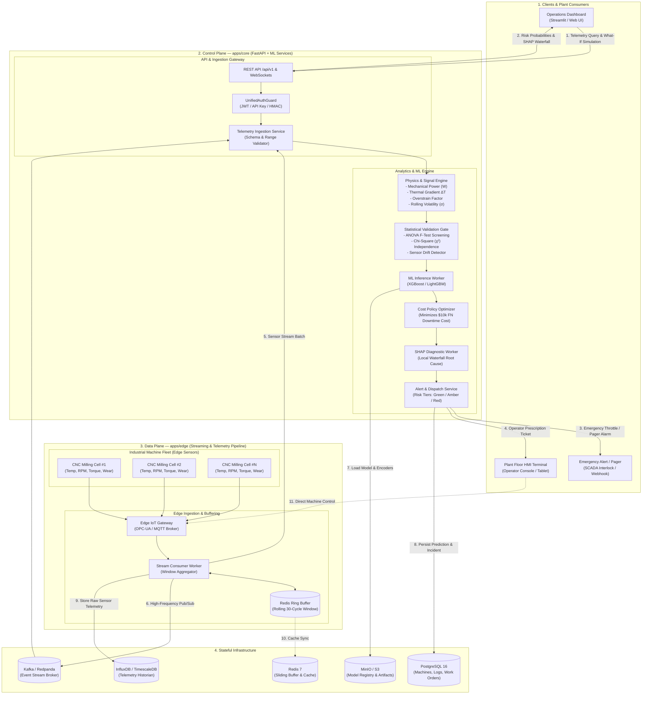

# Enterprise System Architecture & Operational Workflow

## Predictive Maintenance & Equipment Failure Risk Engine

This document outlines the **multi-tier enterprise architecture** for the Predictive Maintenance & Equipment Failure Risk Engine, structured identically to production cloud-native industrial platforms (Clients $\to$ Control Plane $\to$ Data Plane $\to$ Stateful Infrastructure).

---

## 1. Master Enterprise Architecture Diagram

---

## 2. Multi-Tier Subsystem Specifications

### Tier 1: Clients & Plant Consumers
* **Operations Dashboard (Streamlit / React):** 
  * Central control cockpit for maintenance managers and plant engineers.
  * Real-time risk meters, fleet-wide failure probability heatmaps, and interactive sliders for "What-If" simulation.
* **Plant Floor HMI Terminal (Edge Operator Tablet):**
  * Ruggedized touch screens beside CNC machines.
  * Delivers instant localized alerts: *"Warning: Tool wear high. Replace cutting insert within 30 minutes."*
* **Emergency Alert / Pager (SCADA Interlock / Webhooks):**
  * Automated push notifications via Slack, SMS, or direct SCADA relays to throttle spindle RPM when catastrophic risk exceeds $70\%$.

---

### Tier 2: Control Plane (Core Application Services)
The core intelligence engine hosted on FastAPI with asynchronous worker processes:

1. **API & Ingestion Gateway:**
   * `REST API /api/v1`: Endpoint for telemetry ingestion, historical analytics, and risk queries.
   * `UnifiedAuthGuard`: Enforces HMAC / API-Key validation for IoT edge gateways and JWT authentication for human users.
   * `Telemetry Ingestion Service`: Validates input types, sensor physical range boundaries ($T_{\text{air}} > 250\text{K}$, $\text{RPM} > 0$), and discards malformed packets.

2. **Feature Engineering Engine:**
   * Injects physics equations:
     * **Mechanical Power ($W$):** $P = \text{Torque} \times (\text{Speed} \times \frac{2\pi}{60})$
     * **Thermal Gradient ($\Delta T$):** $\Delta T = \text{Process Temp} - \text{Air Temp}$
     * **Overstrain Factor:** $\text{Tool Wear} \times \text{Torque}$
   * Computes dynamic window statistics: rolling mean ($\mu$), rolling standard deviation ($\sigma$), and rate-of-change ($\Delta / \Delta t$).

3. **Statistical Hypothesis Testing Gate:**
   * **One-Way ANOVA:** Compares continuous telemetry distributions between normal vs. breakdown states. Drops features where $p \ge 0.05$.
   * **Chi-Square ($\chi^2$):** Assesses dependence between machine quality tiers (`L`, `M`, `H`) and failure modes.
   * **Drift Detector:** Monitors sensor distributions in production to trigger retraining when machinery shifts.

4. **ML Inference Worker:**
   * High-speed batch/real-time inference using **XGBoost / LightGBM**.
   * Employs `scale_pos_weight \approx 28.5` to account for the $3.4\%$ failure class imbalance.

5. **Cost Policy Optimizer:**
   * Computes expected downtime cost using the industrial financial matrix:
     $$\text{Cost} = (N_{\text{FN}} \times \$10,000) + (N_{\text{FP}} \times \$200) + (N_{\text{TP}} \times \$1,500)$$
   * Shifts the decision threshold from standard $0.50$ down to $\sim 0.25 - 0.35$ to minimize total dollar losses.

6. **SHAP Diagnostic Worker:**
   * Executes TreeSHAP to calculate Shapley feature attribution values.
   * Generates a local waterfall explanation for each flagged machine to prove *why* the alert was triggered.

7. **Alert & Dispatch Service:**
   * Routes events according to the Tri-Tier Decision Matrix:
     * 🟢 **Normal ($< 35\%$):** Log and continue.
     * 🟡 **Warning ($35\% - 70\%$):** Create routine work order for next shift.
     * 🔴 **Critical ($> 70\%$):** Immediate safety interlock and alarm.

---

### Tier 3: Data Plane (Edge & Streaming Telemetry Pipeline)
* **Industrial Machine Fleet:** CNC Milling stations equipped with thermocouples, rotary encoders, and torque sensors.
* **Edge IoT Gateway:** Consolidates sensor data using standard industrial protocols (OPC-UA / MQTT).
* **Stream Consumer Worker:** Aggregates sliding window slices over time intervals.
* **Redis Ring Buffer:** In-memory circular buffer maintaining the last 30 operational cycles per machine to compute rolling volatility and rate-of-change in sub-millisecond time.

---

### Tier 4: Stateful Infrastructure
* **Redis 7:** Ultra-low-latency in-memory cache for rolling sensor buffers and rate-limiting.
* **InfluxDB / TimescaleDB:** High-throughput time-series database storing raw sensor telemetry streams.
* **PostgreSQL 16:** Relational database for machine metadata, user accounts, alert history, and maintenance work orders.
* **MinIO / AWS S3:** Object storage hosting serialized model weights (`.joblib`), pipeline artifacts, and pre-computed SHAP explainers.
* **Kafka / Redpanda:** Distributed event streaming backbone that decouples high-frequency sensor streams from backend ML inference.

---

## 3. Communication Flows (Numbered Sequences)

| Sequence # | Communication Path | Data Transferred | Protocol / Mechanism |
| :---: | :--- | :--- | :--- |
| **1** | Dashboard $\to$ API Gateway | User queries telemetry, filters machines, or runs what-if sliders | HTTP REST / WebSocket |
| **2** | API Gateway $\to$ Dashboard | Returns real-time risk scores, probability gauges, and SHAP plots | JSON / Binary WebSocket |
| **3** | Alert Service $\to$ Emergency Pager | Dispatches critical failure alarm and triggers automated RPM throttle | Webhook / SCADA Relay |
| **4** | Alert Service $\to$ HMI Terminal | Pushes maintenance prescription to operator floor display | WebSocket Push / MQTT |
| **5** | Stream Worker $\to$ Ingestion Service | Submits aggregated sensor window batches for inference | gRPC / HTTP |
| **6** | Stream Worker $\to$ Kafka / Redpanda | Publishes raw sensor telemetry events | Kafka Producer (TCP) |
| **7** | ML Worker $\leftarrow$ MinIO / S3 | Fetches latest trained XGBoost model and preprocessors | S3 API / Boto3 |
| **8** | Alert Service $\to$ PostgreSQL | Stores prediction logs, risk probabilities, and created work orders | SQL / ORM (SQLAlchemy) |
| **9** | Stream Worker $\to$ InfluxDB / TimescaleDB | Persists continuous sensor time-series data for historical auditing | TimescaleDB / Influx Line Protocol |
| **10** | Redis Buffer $\leftrightarrow$ Redis 7 | Synchronizes rolling sliding windows across worker nodes | In-Memory Redis Protocol |
| **11** | HMI Terminal $\to$ Edge Gateway | Manual override or tool replacement acknowledgment from operator | Modbus / OPC-UA |
